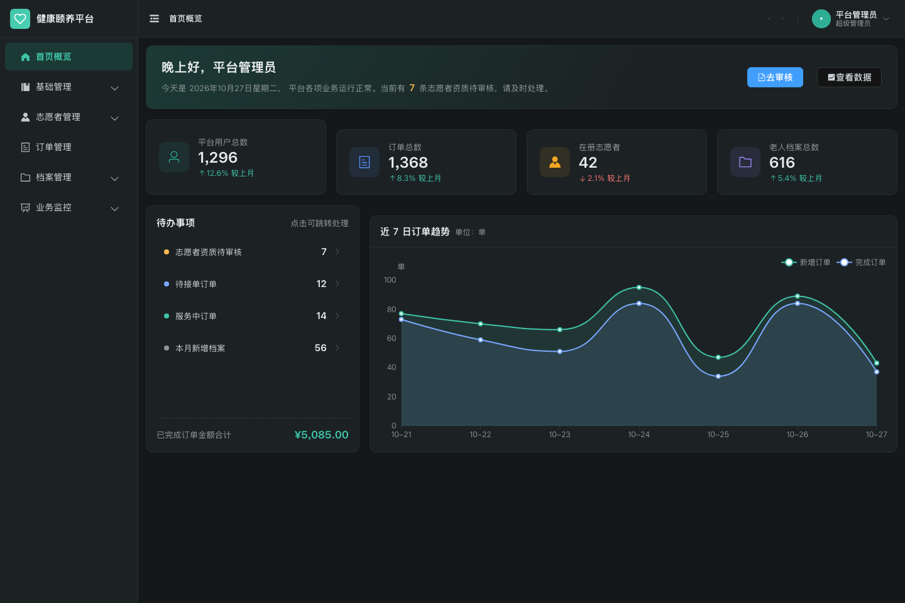

# 健康颐养平台 · 管理端

面向社区销售的本地部署类养老管理平台 —— 管理端前端。

基于 **Vue 3 + Vite + Element Plus + Pinia + ECharts** 开发，实现了平台管理员对基础管理、志愿者管理、订单管理、档案管理、业务监控五大模块的可视化管理界面。

- 学号：202451024195
- 姓名：贺宇涛

---



**在线 Demo**：<https://mikulovehe.github.io/health-care-admin/>（演示账号 `admin` / `123456`）
**项目规模**：5 大业务模块 · 18 个页面 · 28 个 Vue 组件，独立完成
**技术栈**：Vue 3 · Vite · Element Plus · Pinia · ECharts
**数据来源**：前端 Mock（Axios adapter），无需后端即可完整运行

<details>
<summary>展开查看登录页</summary>


</details>

## 快速开始

```bash
# 安装依赖（建议使用 Node 18 及以上版本）
npm install

# 启动开发服务器，默认 http://localhost:5173
npm run dev

# 构建生产版本，产物输出到 dist/
npm run build

# 本地预览构建产物
npm run preview
```

**演示账号**：`admin`　**密码**：`123456`

> 登录页提供了「填入演示账号」按钮，点击后可一键填充。

---

## 技术选型

| 类别 | 选型 | 说明 |
| --- | --- | --- |
| 框架 | Vue 3.5 | 全部使用组合式 API + `<script setup>` 语法 |
| 构建工具 | Vite 8 | 原生 ESM 开发服务器，启动与热更新极快 |
| 路由 | Vue Router 5 | hash 模式 + 路由懒加载 + 全局前置守卫 |
| 状态管理 | Pinia 4 | `user` 管理登录态、`app` 管理侧边栏与主题 |
| UI 组件库 | Element Plus 2.14 | 全量引入，中文语言包 |
| HTTP 请求 | Axios 1.x | 统一封装，含请求/响应拦截器与错误处理 |
| 图表 | ECharts 6 | 折线图、饼图、环形图、柱状图、玫瑰图 |
| 样式 | SCSS + CSS 自定义属性 | 响应式布局，支持亮色/暗黑双主题 |

> 版本以实际 `npm install` 安装并被验证通过的为准；完整版本号见 [项目说明文档.md](./项目说明文档.md)。

### 关于数据来源

本项目为纯前端作业，**没有真实后端**，所有数据由 `src/mock/` 下的 Mock 层提供。

这里没有使用常见的 Mock.js，而是实现了一个 **Axios 自定义 adapter**：请求依然经过真实的 axios 拦截器链路，只是最终由本地路由表响应。这样做的好处是——

- 请求拦截器（注入 Token）、响应拦截器（剥离响应包装、401 跳登录）、统一错误提示**全部真实生效**；
- 将来接入真实后端时，只需删除 `src/utils/request.js` 中的 `adapter` 一行、修改 `baseURL`，**业务代码零改动**。

Mock 数据使用固定随机种子生成，因此每次刷新页面数据保持一致，便于演示与截图。

---

## 目录结构

```
src/
├── api/                    # 接口封装层，按业务模块拆分
│   ├── auth.js             #   登录 / 登出 / 用户信息
│   ├── basic.js            #   服务 / 广告 / 用户 / 辖区
│   ├── volunteer.js        #   志愿者申请审核 / 列表 / 资质
│   ├── order.js            #   订单列表 / 详情 / 统计
│   ├── archive.js          #   档案列表 / 录入 / 批量导入
│   └── monitor.js          #   数据总览 / 图表 / 报表
├── assets/styles/          # 样式
│   ├── variables.scss      #   SCSS 编译期常量（尺寸、圆角）
│   ├── theme.scss          #   亮色/暗黑主题的 CSS 变量定义
│   └── index.scss          #   全局样式入口（重置 + 通用类）
├── components/             # 公共组件
│   ├── PageHeader.vue      #   统一页头
│   ├── SearchBar.vue       #   统一搜索栏
│   ├── StatusTag.vue       #   状态标签（全站状态配色统一）
│   └── ChartCard.vue       #   ECharts 封装（自适应 + 主题联动）
├── layout/                 # 布局
│   ├── index.vue           #   侧边栏 + 顶栏 + 内容区
│   └── components/         #   Sidebar / SidebarItem / Navbar / Breadcrumb
├── mock/                   # Mock 数据层
│   ├── index.js            #   adapter 与路由匹配器
│   ├── db.js               #   内存数据库
│   ├── helper.js           #   分页 / 筛选 / 占位图工具
│   └── modules/            #   各模块接口实现
├── router/                 # 路由
│   ├── index.js            #   路由实例与守卫
│   └── routes.js           #   路由表（同时驱动侧边栏菜单）
├── stores/                 # Pinia 状态
│   ├── user.js             #   登录态与用户信息
│   └── app.js              #   侧边栏折叠与主题
├── utils/                  # 工具
│   ├── request.js          #   Axios 封装
│   ├── auth.js             #   Token 本地持久化
│   ├── format.js           #   日期 / 金额 / 脱敏 / 身份证
│   └── constants.js        #   全局业务字典
├── views/                  # 业务页面
│   ├── login/              #   登录页
│   ├── dashboard/          #   首页概览
│   ├── basic/              #   基础管理（服务/广告/用户/辖区）
│   ├── volunteer/          #   志愿者管理（审核/列表/资质详情）
│   ├── order/              #   订单管理（列表/详情）
│   ├── archive/            #   档案管理（列表/录入/批量导入）
│   ├── monitor/            #   业务监控（总览/图表/报表）
│   └── error/              #   404
├── App.vue
└── main.js
```

---

## 功能清单

### 一、基础管理

| 页面 | 实现功能 |
| --- | --- |
| 服务管理 | 服务列表增删改查、上下架状态切换、按分类/状态/关键字筛选、详情抽屉 |
| 广告管理 | 广告位列表、图片上传与实时预览、投放时间范围设置与校验、上下架、点击量统计 |
| 用户管理 | 用户列表、多条件搜索、详情抽屉（敏感信息脱敏，可切换明文）、禁用/启用 |
| 辖区范围管理 | 三级树形结构（区-街道-社区）、节点搜索过滤、增删改查、选中节点详情与下级列表 |

### 二、志愿者管理

| 页面 | 实现功能 |
| --- | --- |
| 志愿者申请审核 | 待审核列表、资质证件预览、通过/驳回（驳回强制填写原因）、审核后自动移出待审队列 |
| 志愿者列表 | 手动添加、编辑、删除、按资质状态/技能/关键字查询、服务时长与次数统计 |
| 资质详情 | 证件材料网格预览（支持大图查看）、审核记录时间轴、资质作废与恢复 |

### 三、订单管理

| 页面 | 实现功能 |
| --- | --- |
| 订单列表 | 状态快捷筛选标签、按状态/时间/服务类型/关键字组合筛选、分页查询、取消订单 |
| 订单详情 | 状态流转进度条、服务内容、下单人信息、服务志愿者、支付信息、完整流转记录时间轴 |

### 四、档案管理

| 页面 | 实现功能 |
| --- | --- |
| 档案列表 | 老人信息列表、按辖区/年龄段/健康情况筛选、搜索、详情抽屉、编辑、删除 |
| 档案录入 | 分组表单（基本信息/健康信息/监护人）、完整校验规则、身份证自动计算年龄、健康情况联动护理等级 |
| 批量导入 | CSV 模板下载（含 UTF-8 BOM，Excel 打开不乱码）、文件格式与大小校验、导入结果统计与明细 |

### 五、业务监控

| 页面 | 实现功能 |
| --- | --- |
| 数据总览 | 关键指标卡片（用户数/订单数/志愿者数/档案数，含环比）、次级指标、订单状态环形图、服务类型玫瑰图、辖区分布柱状图、志愿者服务时长排行 |
| 图表分析 | 订单趋势折线图（可切换指标）、服务类型饼图、辖区资源分布柱状图、志愿者排行横向柱状图 |
| 业务报表 | 按周/月/季度切换统计周期、汇总卡片、趋势组合图、明细表（带合计行）、导出 CSV |

### 扩展功能（加分项）

- **暗黑模式**：顶栏一键切换，全站（含 Element Plus 组件与所有 ECharts 图表）同步跟随，选择结果持久化到本地。
- **全屏显示**：顶栏提供全屏切换按钮。
- **响应式布局**：适配 1366×768 及以上分辨率，窄屏下自动收紧间距、侧边栏可折叠。

---

## 实现要点

### 1. 菜单与路由单一数据源

侧边栏菜单**由路由表 `src/router/routes.js` 递归生成**（见 `layout/components/Sidebar.vue`），而非单独维护一份菜单配置。这样从根本上杜绝了「菜单点了跳 404」的问题，新增页面只需在路由表中加一项，菜单自动出现。

路由通过 `meta` 字段控制菜单行为：`title` 菜单标题、`icon` 图标、`hidden` 是否隐藏、`activeMenu` 隐藏页面（如详情页）高亮哪个父级菜单。

### 2. 全站主题通过 CSS 自定义属性实现

所有颜色定义在 `src/assets/styles/theme.scss` 的 `:root` 中，暗黑模式用 `html.dark` 覆盖同名变量。切换主题只需切换 `<html>` 上的 `dark` 类，**无需任何组件做条件渲染**，Element Plus 组件库也会自动跟随（因为它同样使用 CSS 变量）。

> 开发过程中踩过一个坑：最初把 CSS 变量和 SCSS 常量放在同一个文件里，而该文件被 20 多个组件 `@use`。Sass 会把被引入文件的 CSS 输出复制到每一处引用点，导致变量块被重复输出 20 多遍。现已拆分为 `variables.scss`（纯 SCSS 常量，可安全引用）和 `theme.scss`（产出 CSS 变量，只在入口引入一次）。

### 3. ECharts 的主题联动

ECharts 无法读取 CSS 变量，因此 `components/ChartCard.vue` 内置了明暗两套调色板，监听主题状态变化后重新 `setOption` 绘制。同时通过 `ResizeObserver` 监听容器尺寸变化（侧边栏折叠、窗口缩放都会触发），自动调用 `resize()`，并在组件卸载时销毁实例避免内存泄漏。

### 4. 数据校验前后端双重保障

以档案录入为例，身份证号在**前端表单**和 **Mock 服务端**各自独立校验一次（含 GB 11643 校验码算法）。前端校验负责交互体验，服务端校验负责数据正确性——这也是真实项目应有的做法。身份证号同时做了唯一性校验，年龄由证件号自动推导，避免人工填写与证件不一致。

### 5. 表格列宽的响应式取舍

作业要求适配 1366×768 及以上分辨率。在 1366 宽度下，内容区可用宽度仅 1088px，若每个字段独占一列，表格必然横向溢出，导致靠右的列被固定操作列遮挡。因此对字段做了合并取舍，例如：

- 服务管理：时长、评分折入「服务信息」列
- 用户管理：注册时间与最近登录合并为一列
- 订单管理：下单人与服务志愿者合并为一列
- 档案管理：健康情况与慢病标签合并为一列

这样保证在最窄的目标分辨率下，**所有列都能完整显示、无横向滚动**。

---

## 性能优化

图表库最初通过 `import * as echarts from 'echarts'` 全量引入，仅图表模块就占 1 MB。改为 `echarts/core` 按需注册（柱状图、折线图、饼图 + 必需组件 + Canvas 渲染器）后：

| 指标 | 优化前 | 优化后 | 变化 |
|---|---|---|---|
| 图表 chunk（原始） | 1095.2 kB | 558.4 kB | -49.0% |
| 图表 chunk（gzip） | 372.5 kB | 187.4 kB | -49.7% |
| 全站 JS（gzip） | 804.0 kB | 632.3 kB | -21.4% |

按需注册入口见 [`src/utils/echarts.js`](src/utils/echarts.js)。新增图表类型时需同步注册对应的 Chart 与 Component，否则图表不会渲染。

## 已知说明

- 本项目所有数据均为 Mock 数据，刷新页面后增删改查的结果会重置。
- 广告图片上传为纯前端处理（读取为 base64 预览），不发送真实上传请求，因此断网也能完整演示。
- 批量导入的「文件解析」环节由前端模拟（页面提供「演示模式」开关），真实项目中应把文件流交给后端解析，页面交互无需改动。
- 构建产物体积较大的主要来源是 Element Plus 与 ECharts 的全量引入；若需优化可改为按需引入，但会牺牲一部分配置的稳定性。

---

## AI 使用说明

详见 [项目说明文档.md](./项目说明文档.md) 中的「AI 使用说明」章节。
